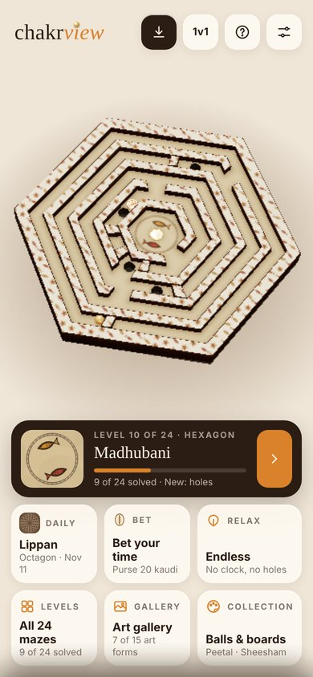
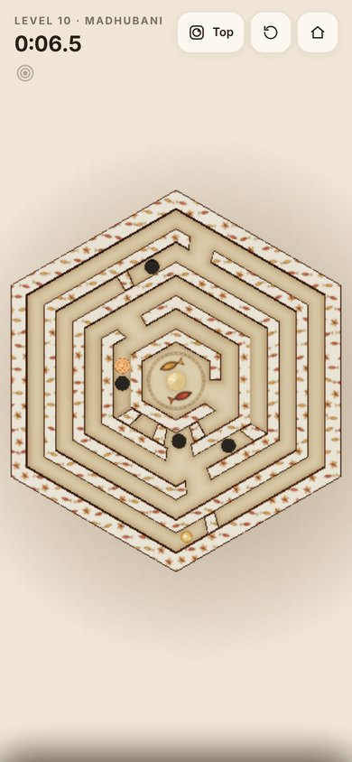
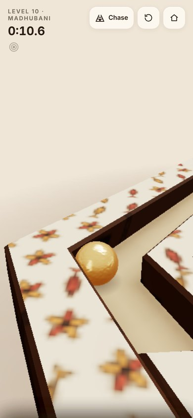
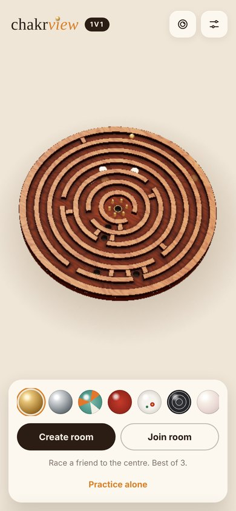

<h1 align="center">chakrview</h1>

<i>Indian art meets tactile play.</i> 
Tilt a carved board. Roll the ball. Find your way to the centre.

  
  
  
  

---

Chakrview is a calm ball-and-maze game, a digital version of the wooden labyrinths you tilt with both hands. Tilt your phone and the ball rolls: it clicks against walls, slows in sand, slides on brass and drops into holes. It's made to pick up after a long day, at any age from 5 to 55.

## The Journey

24 hand-tuned mazes that move from gentle to devious:

| Board shape | Levels |
|-------|--------|
| Circle | 1–6 |
| Hexagon | 7–16 |
| Octagon | 17–24 |

Every level is carved from a different Indian craft or folk art: **Sheesham, Chandan, Akhrot, Makrana marble, Neel, Bidri, Warli, Madhubani, Kolam, Gond, Kalamkari, Lippan, Pattachitra, Pichwai and Sanjhi**.

New mechanics arrive one at a time: blocking bars, brass posts, a turning ring, sand, polished brass, dead ends and holes.

**The twist.** From level 6, a brass lotus closes the centre. Somewhere in the maze, often down a dead end, is a copper temple gong. Roll over it, hear it ring, and watch the lotus bloom open.

## Ways to play

- **Daily maze.** One new maze each day, the same for everyone. Keep your streak going.
- **Relax.** Endless mazes with no clock and no holes, over a soft ambience of breeze and wind chimes.
- **Bet your time.** Study a fresh maze, bet how many seconds you'll need, and stake cowrie shells (*kaudi*). Bolder bets pay higher odds.
- **Challenge a friend.** Send a link to the maze you just solved. Your friend races your ghost ball on the same board.
- **1v1 Duel.** Two phones, one room code, one big maze. Race marbles to the centre, best of three rounds.

## Two views, one maze

**Top** shows the whole board so you can plan a route. **Chase** drops you behind the ball and the board turns with it. Switch any time.

## Crafted balls

Twelve balls, each with its own weight, bounce and grip: hammered-brass *Peetal*, steel *Fauladi*, a gully *Kancha* marble, lacquered *Channapatna* wood, *Moti* pearl, *Mitti* terracotta, *Rudraksha* seed, *Meenakari* enamel, *Chandi* filigree and more. They unlock as you travel the Journey.

## Art gallery

Each art form has a card that fills in as you finish its levels. Open one to read where the craft comes from.

## Feel

- **Sound:** a soft rolling hush, gentle wall taps, and a bell each time you pass into a new ring.
- **Touch:** on Android, light vibration as the ball crosses sand.
- **No pressure:** no jingles and no "game over". A hole only sends you back one ring.

## Controls

| | Phone | Computer |
|---|---|---|
| Roll | Tilt the phone, or drag | Arrow keys / WASD, or drag |
| Switch view | Camera button | `V` |
| Restart | ↺ | `R` |
| Re-level tilt | ◎ | — |

Chakrview installs like an app on your home screen and plays offline. Rooms in the Duel need the internet to connect.

---

Built with three.js · Duel rooms by PeerJS · No ads, no tracking, progress stays on your device.

